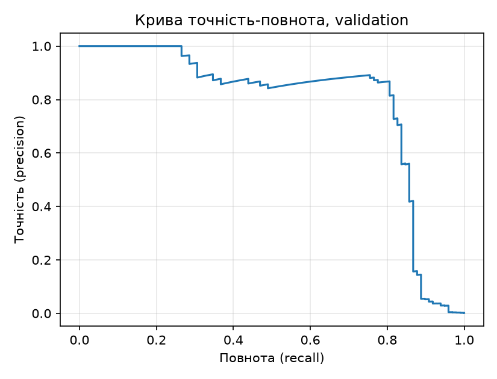
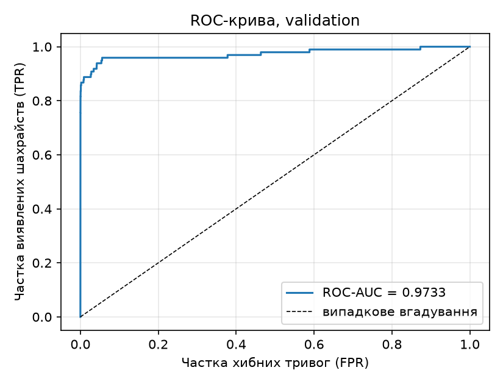

# ЛР2. Поріг рішення під асиметричну ціну помилок

Дані: [Credit Card Fraud Detection (Kaggle)](https://www.kaggle.com/datasets/mlg-ulb/creditcardfraud)

## Запуск

```bash
cd lab2
uv run python lab2_starter.py --data /шлях/до/creditcard.csv --out results
uv run python lab2_analysis.py --saved results
```

## Структура теки

```
lab2/
├── lab2_starter.py            навчання і збереження прогнозів (стартовий код викладача; додано лише UTF-8 для stdout/stderr у `main`)
├── lab2_analysis.py           мій код: TP/FP/FN/TN, C, пошук порога, перевірки A/B/C, тест, помилки
├── pyproject.toml, uv.lock    залежності із зафіксованими версіями
├── README.md
├── creditcard.csv             
└── results/                   
    ├── model.pt                    ваги моделі
    ├── preprocessing.npz           статистики StandardScaler 
    ├── predictions.npz             індекси поділу (*_row_ids), мітки, оцінки, сирий Amount
    ├── split_summary.csv           розміри та частка шахрайств у train/validation/test
    ├── validation_candidates.csv   повна таблиця кандидатів: поріг, TP, FP, FN, TN, C
    ├── threshold.json              зафіксований поріг t*
    ├── pr_curve.png, roc_curve.png криві на validation
    ├── check_A.csv, check_B.csv, check_C.csv   перевірки пошуку порога
    ├── test_metrics.json           тестова оцінка
    └── test_errors_top5.csv        перші 5 FP і 5 FN за номером рядка CSV
```

## 1. Поділ

Поділ 60/20/20 стратифікований, порядок рядків збережено (`train_test_split(test_size=0.4, stratify=Class, random_state=0)`, далі відкладені навпіл, `random_state=0`). Ознаки: V1-V28 і Amount (29), Time і Class не входять до моделі; сирий Amount збережено окремо.

| вибірка | n | шахрайських | частка |
|---|---|---|---|
| train | 170 884 | 295 | 0,001726 |
| validation | 56 961 | 98 | 0,001720 |
| test | 56 962 | 99 | 0,001738 |

`StandardScaler` навчено лише на train. Якби середнє й σ рахувати на всьому наборі, у них потрапила б інформація про validation/test (витік даних): оцінка якості стала б оптимістичною, а test перестав би бути «невидимим».

Навчання: 12 епох, BCE 0,365 → 0,0034, ваги останньої епохи. Оцінки s = sigmoid(z) отримано в `eval()` без градієнтів.

## Формули

Нехай $s_i$ - оцінка моделі (імовірність шахрайства), $y_i\in\{0,1\}$ - мітка, $t$ - поріг. Прогноз $\hat y_i(t)=1$, якщо $s_i \ge t$, інакше 0. Тоді

$$TP(t)=\sum_i [\hat y_i=1,\ y_i=1],\quad FP(t)=\sum_i [\hat y_i=1,\ y_i=0],$$
$$FN(t)=\sum_i [\hat y_i=0,\ y_i=1],\quad TN(t)=\sum_i [\hat y_i=0,\ y_i=0].$$

Вартість помилок (Amount у неї не входить):

$$C(t)=10\cdot FN(t)+FP(t).$$

Метрики якості:

$$\text{precision}=\frac{TP}{TP+FP},\qquad \text{recall}=TPR=\frac{TP}{TP+FN},\qquad FPR=\frac{FP}{FP+TN}.$$

Якщо знаменник дорівнює нулю, метрика не визначена. ROC-AUC - площа під кривою $TPR(FPR)$, що дорівнює ймовірності $P(s_{\text{позитив}} > s_{\text{негатив}})$ (рівні оцінки рахуються з вагою 1/2).

Пошук порога. Нехай $u_1<\dots<u_m$ - унікальні оцінки validation, $p_k$ і $q_k$ - кількість позитивів і негативів з оцінкою рівно $u_k$, $P=\sum p_k$, $N=\sum q_k$. Для кандидата $t=u_k$:

$$TP=\sum_{j\ge k}p_j,\quad FP=\sum_{j\ge k}q_j,\quad FN=P-TP,\quad TN=N-FP.$$

Кандидат $t=+\infty$: $TP=FP=0$, $FN=P$, $TN=N$. Найменший кандидат $u_1$ відповідає «усі позитивні». Шуканий поріг

$$t^*=\max\{\,t:\ C(t)=\min_{t'}C(t')\,\}.$$

## 2. Поріг на validation

Прогноз 1, якщо s ≥ t. TP/FP/FN/TN рахуються як кількість об'єктів у відповідних комірках; **C(t) = 10·FN + FP** (Amount у вартість не входить).

**Алгоритм (O(n log n)).** `np.unique` сортує оцінки та групує рівні значення; для кожної групи рахуємо кількість позитивних і негативних. Для порога t = u_k прогноз «1» отримують усі групи від k до кінця, тому TP та FP — суфіксні кумулятивні суми, FN = P − TP, TN = N − FP. Рівні оцінки лежать в одній групі й завжди мають однаковий прогноз. До кандидатів додано +∞ (TP=FP=0, усі негативні). Таблиця впорядкована за спаданням порога, а `idxmin` повертає перший мінімум, тобто **при рівній вартості береться більший поріг**.

| правило на validation | поріг | TP | FP | FN | TN | C |
|---|---|---|---|---|---|---|
| Стандартний 0,5 | 0,5 | 71 | 9 | 27 | 56 854 | 279 |
| Мінімум вартості t* | 0,03119390830397606 | 82 | 34 | 16 | 56 829 | 194 |
| Усі негативні | +∞ | 0 | 0 | 98 | 56 863 | 980 |

ROC-AUC (validation) = 0,97332.




**Чому висока ROC-AUC не гарантує малої вартості чи високої precision.** ROC-AUC — ймовірність, що випадковий позитив має вищу оцінку за випадковий негатив: вона оцінює лише ранжування і не залежить від порога, від співвідношення класів та від цін помилок. При 0,17 % позитивів навіть мала FPR дає багато FP порівняно з 98 позитивами, тож precision може бути низькою; а ціна 10:1 вимагає конкретної точки на кривій, про яку AUC нічого не каже. Для сильного дисбалансу інформативніша PR-крива.

## 3. Перевірка пошуку на малих наборах

Швидка таблиця порівнювалась з незалежним повільним перебором (`brute_table`: для кожного кандидата окремо застосовується `s >= t` до всієї вибірки). Усі лічильники та C збігаються точно, вибрані пороги збігаються (`run_checks` кидає помилку при розбіжності і виконується перед тестовою оцінкою). Таблиці: `results/check_*.csv`.

Таблиці кандидатів (швидка й повільна версії дали однакові):

**Набір A**, $s=[0{,}9;0{,}7;0{,}7;0{,}4;0{,}2;0{,}1]$, $y=[0;1;0;1;0;0]$, t* = 0,4

| поріг | TP | FP | FN | TN | C |
|---|---|---|---|---|---|
| +∞ | 0 | 0 | 2 | 4 | 20 |
| 0,9 | 0 | 1 | 2 | 3 | 21 |
| 0,7 | 1 | 2 | 1 | 2 | 12 |
| 0,4 | 2 | 2 | 0 | 2 | 2 |
| 0,2 | 2 | 3 | 0 | 1 | 3 |
| 0,1 | 2 | 4 | 0 | 0 | 4 |

**Набір B**, $s=[0{,}9;0{,}6;0{,}3]$, $y=[0;0;0]$, t* = +∞

| поріг | TP | FP | FN | TN | C |
|---|---|---|---|---|---|
| +∞ | 0 | 0 | 0 | 3 | 0 |
| 0,9 | 0 | 1 | 0 | 2 | 1 |
| 0,6 | 0 | 2 | 0 | 1 | 2 |
| 0,3 | 0 | 3 | 0 | 0 | 3 |

**Набір C**, $s=[0{,}8;\ 11\times0{,}5;\ 0{,}2]$, $y=[1;\ 1,\ 0\times10;\ 0]$, t* = 0,8

| поріг | TP | FP | FN | TN | C |
|---|---|---|---|---|---|
| +∞ | 0 | 0 | 2 | 11 | 20 |
| 0,8 | 1 | 0 | 1 | 11 | 10 |
| 0,5 | 2 | 10 | 0 | 1 | 10 |
| 0,2 | 2 | 11 | 0 | 0 | 11 |

Що перевіряє кожен набір:

| набір | t* | чому важливий |
|---|---|---|
| A: `[.9,.7,.7,.4,.2,.1]`, `[0,1,0,1,0,0]` | 0,4 (C=2) | дві оцінки 0,7 мають однаковий прогноз: кандидат 0,7 дає TP=1, FP=2, а не «половину» групи |
| B: `[.9,.6,.3]`, усі 0 | +∞ (C=0) | немає позитивів: будь-який скінченний поріг лише додає FP; перевіряє граничний кандидат +∞ і TP+FN=0 |
| C: `0.8` і 11×`0.5`, `0.2` | 0,8 (C=10) | C(0,8)=10 і C(0,5)=10 — нічия, береться більший поріг 0,8 |

## 4. Тест (t* = 0,03119390830397606, зафіксовано на validation)

| TP | FP | FN | TN | C | precision | recall |
|---|---|---|---|---|---|---|
| 80 | 43 | 19 | 56 820 | 233 | 80/123 = 0,6504 | 80/99 = 0,8081 |

precision = TP/(TP+FP), recall = TP/(TP+FN). Якщо знаменник нульовий (модель нічого не позначила або в test немає шахрайств), метрика не визначена: ділення 0/0 не має змісту; у цьому прогоні обидва знаменники ненульові. Порогу, моделі й налаштувань test не змінювали.

Перші п'ять FP і FN за номером рядка CSV:

| рядок CSV | тип | мітка | s | Amount | s − t* |
|---|---|---|---|---|---|
| 460 | FP | 0 | 0,1962 | 2,00 | +0,165 |
| 2961 | FP | 0 | 0,0810 | 2,49 | +0,050 |
| 10783 | FP | 0 | 0,9663 | 89,99 | +0,935 |
| 13405 | FP | 0 | 0,9320 | 89,99 | +0,901 |
| 13617 | FP | 0 | 0,9228 | 89,99 | +0,892 |
| 10497 | FN | 1 | 0,0115 | 3,79 | −0,020 |
| 52521 | FN | 1 | 0,0064 | 105,99 | −0,025 |
| 55401 | FN | 1 | 0,0056 | 1,00 | −0,026 |
| 91671 | FN | 1 | 0,0005 | 290,18 | −0,031 |
| 93486 | FN | 1 | 0,0184 | 0,00 | −0,013 |

**Amount і відстань від порога.** FP бувають і дуже близько до порога (0,05), і дуже впевнені (s≈0,97, три записи з Amount = 89,99). FN лежать усі трохи нижче порога (відстань 0,013-0,031), крім 91671 з s≈0,0005. Amount серед FN різний (від 0 до 290), простого зв'язку з сирою сумою не видно. Десяти прикладів недостатньо, щоб робити висновки про причини: вибірка мала, відібрано лише найменші номери рядків (не випадково), V1-V28 анонімізовані, тож без аналізу всіх помилок і ознак причину встановити не можна.

## Висновок

Модель не змінювалась, змінився лише поріг: з 0,5 на t* ≈ 0,031. На validation це дало 11 додаткових виявлених шахрайств (FN: 27 → 16) ціною 25 додаткових хибних тривог (FP: 9 → 34), і C впала з 279 до 194, бо один FN коштує 10 FP. Validation не гарантує такого самого виграшу на test: t* підібрано під конкретні 98 шахрайств validation, а в test інші 99 шахрайств та інші негативи, і при такій малій кількості позитивів кілька транзакцій помітно зсувають C. На test C = 233 (FN 19, FP 43).

## Джерела

Звіт та код написано за допомогою Claude Code.
