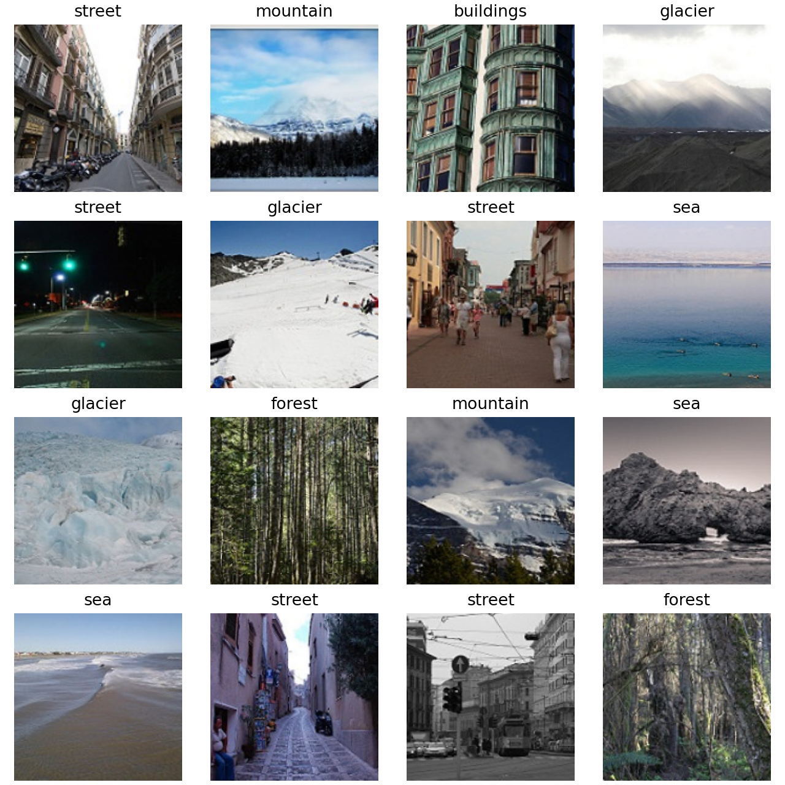
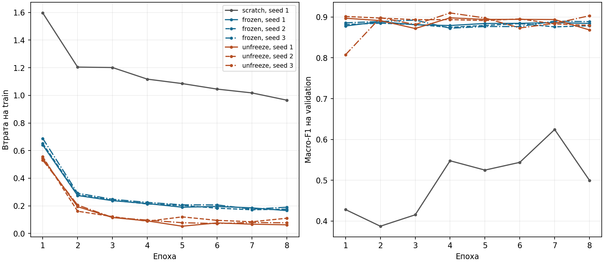
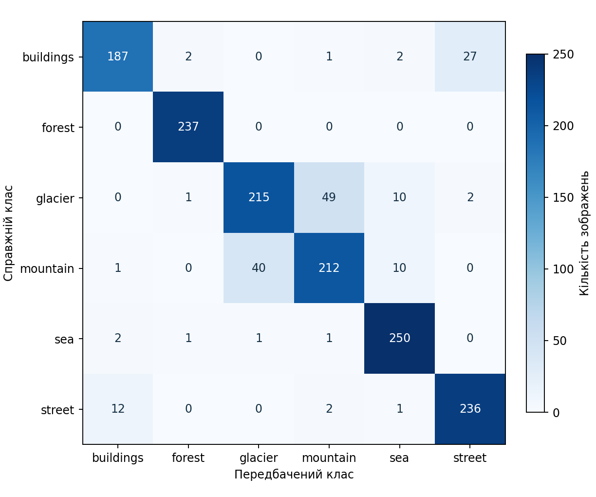
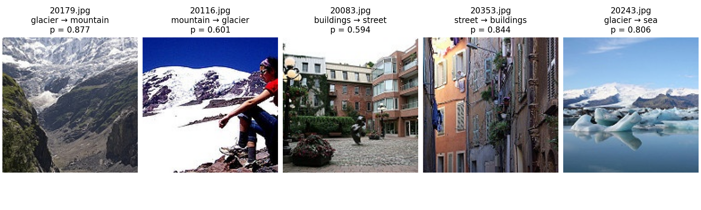

# ЛР3. Обчислювальний експеримент і трансферне навчання

Порівняно три способи навчання ResNet-18 для класифікації сцен на малій вибірці. Для всіх запусків використано однакові дані, перетворення й кількість кроків оптимізатора.

## Відтворення

Дані — [Intel Image Classification](https://www.kaggle.com/datasets/puneet6060/intel-image-classification). Шлях `/шлях/до/intel` вказує на теку, яка містить `seg_train/seg_train/` та `seg_test/seg_test/`.

```bash
cd lab3
uv run --locked python lab3_train.py --data "/шлях/до/intel"
uv run --locked python lab3_analysis.py --data "/шлях/до/intel"
```

Для навчання автоматично вибирається CUDA, MPS або CPU. Для запуску на NVIDIA GPU у першій команді можна вказати `--device cuda`. Для першого навчання потрібні ваги ImageNet, які завантажує torchvision. Другу команду можна запустити одразу зі збереженими результатами. Вона перевіряє SHA-256 поділу в усіх семи журналах, правило вибору і хеш ваг, після чого оцінює модель на CPU.

Для повторного навчання зі збереженням результатів цього звіту в обох командах слід вказати однакове `--out /шлях/до/нової_теки`.

Контрольні перевірки виводяться в консоль. Ваги окремих запусків зберігаються в тимчасовій теці до вибору моделі, після чого залишається `lab3_model.pt`.

| Файл | Вміст |
|---|---|
| `lab3_train.py` | поділ, завантаження зображень, перевірки, навчання семи моделей і збереження ваг вибраної |
| `lab3_analysis.py` | криві, розклад ефектів, тест на CPU та аналіз помилок |
| `split.csv` | фіксований поділ |
| `runs/*/run.json`, `runs/*/val_logits.npy` | журнали й логіти validation восьмої епохи у порядку `split.csv` |
| `results/` | чотири рисунки для звіту |
| `lab3_model.pt` | ваги вибраного запуску для ЛР4 |
| `pyproject.toml`, `uv.lock` | залежності й точні версії |

## 1. Перевірки до навчання

У кожній теці імена файлів відсортовано як рядки. Для `seg_train` індекси кожного класу по черзі перемішано одним генератором `default_rng(0)` і відібрано перші 200. Для `seg_test` створено новий генератор із тим самим зерном, а перемішані індекси кожного класу поділено навпіл. Під час навчання читаються зображення train і validation за `split.csv`. Імена для test фіксуються під час створення поділу, а самі зображення вперше читаються в команді аналізу.

| Клас | train, кількість / сума | validation, кількість / сума | test, кількість / сума |
|---|---:|---:|---:|
| buildings | 200 / 1 996 761 | 218 / 4 837 323 | 219 / 4 837 559 |
| forest | 200 / 2 032 625 | 237 / 5 276 962 | 237 / 5 291 326 |
| glacier | 200 / 2 183 923 | 276 / 6 135 652 | 277 / 6 157 250 |
| mountain | 200 / 1 950 345 | 262 / 5 789 535 | 263 / 5 849 765 |
| sea | 200 / 1 987 613 | 255 / 5 655 068 | 255 / 5 668 011 |
| street | 200 / 1 841 817 | 250 / 5 541 845 | 251 / 5 547 533 |
| Разом | 1 200 / 11 993 084 | 1 498 / 33 236 385 | 1 502 / 33 351 444 |

Кількості зображень і суми їхніх номерів збігаються з умовою. Кожне ім’я файлу трапляється в `split.csv` лише раз.

Pillow відкриває зображення в RGB. Для train застосовано `RandomResizedCrop(160, scale=(0.7, 1.0))` і горизонтальне віддзеркалення з імовірністю 0,5. Для validation і test — `Resize((160, 160))`. Після цього в усіх частинах іде `ToTensor()` і нормування ImageNet із середніми (0,485, 0,456, 0,406) та стандартними відхиленнями (0,229, 0,224, 0,225). На рисунку нормування обернено для перших 16 зображень навчального пакета.



Початкова втрата виміряна на першому пакеті із seed 1 до оновлення ваг.

| Модель | Cross-entropy |
|---|---:|
| Однакові ймовірності шести класів, $\ln 6$ | 1,791759 |
| scratch | 2,047884 |
| frozen | 1,924394 |

В обох моделей новий випадковий `fc` дає нерівні логіти. Для цього пакета геометричне середнє ймовірностей, присвоєних справжнім міткам, менше за $1/6$, тому втрата вища за $\ln 6$. Прямий прохід у `scratch` уже оновлює буфери BN навіть під `torch.no_grad()`, тому для навчання створюється нова модель.

## 2. Перевірка режимів

У всіх режимах 11 179 590 параметрів. Підрахунок — сума `numel()`. Код звіряє список тензорів в AdamW з усіма тензорами, що мають `requires_grad=True`.

| Режим | Початкові ваги кістяка | Параметрів навчається | Групи AdamW (параметри, lr) | Модулі в `eval()` під час навчання |
|---|---|---:|---|---|
| scratch | випадкові | 11 179 590 | усі: 11 179 590, 0,003 | — |
| frozen | ImageNet V1 | 3 078 | fc: 3 078, 0,003 | conv1, bn1, layer1–layer4 |
| unfreeze | ImageNet V1 | 8 396 806 | fc: 3 078, 0,003; layer4: 8 393 728, 0,0003 | conv1, bn1, layer1–layer3 |

У всіх групах AdamW `weight_decay=0.0001`. Для `layer4` у `unfreeze` крок удесятеро менший за крок `fc`, щоб повільніше змінювати вже навчені ознаки, поки нова голова пристосовується до шести класів.

### Зміни після п’яти кроків

Кожну перевірку розпочато з нової моделі з seed 1. Повний `state_dict()` до і після п’яти кроків порівняно за допомогою `torch.equal`. Дві колонки на режим показують, чи змінився хоча б один параметр і хоча б одна ковзна статистика відповідного модуля.

| Модуль | frozen: параметри | frozen: BN | unfreeze: параметри | unfreeze: BN | Збіг з очікуванням для обох |
|---|---|---|---|---|---|
| conv1 | ні | немає BN | ні | немає BN | так |
| bn1 | ні | ні | ні | ні | так |
| layer1 | ні | ні | ні | ні | так |
| layer2 | ні | ні | ні | ні | так |
| layer3 | ні | ні | ні | ні | так |
| layer4 | ні | ні | так | так | так |
| fc | так | немає BN | так | немає BN | так |

Лічильники `num_batches_tracked` змінилися в тих самих модулях, що й ковзні статистики.

### Навмисна помилка з BN

Перед запуском п’яти кроків записано прогноз. У `frozen` зі звичайним `model.train()` параметри кістяка залишаться сталими, а `running_mean`, `running_var` і лічильники BN зміняться. Втрата на train може спадати, тож сама крива не покаже помилки.

| Модуль | Параметри змінилися | Ковзні статистики BN змінилися | Збіг із прогнозом |
|---|---|---|---|
| conv1 | ні | немає BN | так |
| bn1 | ні | так | так |
| layer1 | ні | так | так |
| layer2 | ні | так | так |
| layer3 | ні | так | так |
| layer4 | ні | так | так |
| fc | так | немає BN | так |

У `layer1.0.bn1` максимальна абсолютна зміна `running_mean` становила **0,092836**, а `running_var` — **0,120314**. Втрата загалом спадала, тож за нею самою цю помилку можна було пропустити.

`requires_grad=False` вимикає градієнти параметрів. `running_mean`, `running_var` і лічильник — буфери, які BN оновлює під час прямого проходу в `train()`. Для замороженого кістяка `eval()` фіксує статистики ImageNet. У `unfreeze` ваги `layer4` адаптуються під нові сцени, тому його BN теж має підлаштовувати статистики до нових активацій.

## 3. Сім запусків

У кожному запуску 8 епох по 38 кроків. Train перемішується на кожній епосі, розмір пакета 32, останнього — 16. Validation використовує пакети по 64 у порядку `split.csv`. Втрату за епоху обчислено за формулою $\sum_b L_b |b| / 1200$, де $L_b$ — середня cross-entropy пакета до кроку AdamW. Для кожного класу $F1_k = 2TP_k/(2TP_k+FP_k+FN_k)$. Macro-F1 — середнє шести $F1_k$. У таблиці наведено показники восьмої епохи. Для подальшої оцінки використано ваги тієї самої епохи.

Навчання виконано у float32. У час запуску включено validation після кожної епохи. Перетворені зображення validation кешуються в RAM до відліку часу в усіх режимах, а train-аугментації виконуються заново на кожному проході.

| # | Режим | Зерно | Втрата train (8) | Macro-F1 validation (8) | Час, с |
|---|---|---:|---:|---:|---:|
| 1 | scratch | 1 | 0.965209 | 0.499624 | 163.78 |
| 2 | frozen | 1 | 0.165453 | 0.884201 | 102.33 |
| 3 | frozen | 2 | 0.175656 | 0.878500 | 36.45 |
| 4 | frozen | 3 | 0.189583 | 0.888596 | 34.92 |
| 5 | unfreeze | 1 | 0.062435 | 0.868293 | 37.71 |
| 6 | unfreeze | 2 | 0.110034 | 0.879661 | 37.04 |
| 7 | unfreeze | 3 | 0.077165 | 0.903146 | 33.32 |

За однакової кількості кроків час запусків відрізнявся. У `scratch` градієнти обчислюються для всієї мережі, у `frozen` — лише для голови, а в `unfreeze` — для голови й останнього блоку. Медіанний час `frozen` та `unfreeze` був близьким. На перші запуски могла вплинути паралельна підготовка середовища.



## 4. Розклад ефектів

Для кожного режиму з трьома запусками $\bar F_r = (F_{r,1}+F_{r,2}+F_{r,3})/3$, а розмах $R_r = \max_s F_{r,s} - \min_s F_{r,s}$. Поріг шуму $R = \max(R_{\mathrm{frozen}}, R_{\mathrm{unfreeze}})$.

$$
\Delta_{\mathrm{pre}} = \bar F_{\mathrm{frozen}} - F_{\mathrm{scratch},1},
\qquad
\Delta_{\mathrm{unf}} = \bar F_{\mathrm{unfreeze}} - \bar F_{\mathrm{frozen}}.
$$

Сума $\Delta_{\mathrm{pre}} + \Delta_{\mathrm{unf}}$ — повний виграш трансферу відносно `scratch`. Якщо $|\Delta|\le R$, різниця вкладається в розкид. За $|\Delta|>R$ ефект вартий подальшої перевірки. За нормального розподілу очікуваний розмах трьох значень приблизно $1{,}69\sigma$, а стандартна похибка різниці двох незалежних середніх по три запуски — $0{,}82\sigma$ за однакового $\sigma$. Сам розмах нестабільний на трьох спостереженнях, особливо коли ефект близький до $R$.

| Величина | Значення |
|---|---:|
| $\bar F_{\mathrm{frozen}}$ | 0.883766 |
| $R_{\mathrm{frozen}}$ | 0.010095 |
| $\bar F_{\mathrm{unfreeze}}$ | 0.883700 |
| $R_{\mathrm{unfreeze}}$ | 0.034853 |
| $R$ | 0.034853 |
| $\Delta_{\mathrm{pre}}$ | +0.384141 |
| $\Delta_{\mathrm{unf}}$ | −0.000065 |
| $\Delta_{\mathrm{pre}} + \Delta_{\mathrm{unf}}$ | +0.384076 |

Зерно впливає на початкові ваги нової голови, порядок пакетів і випадкові аугментації в усіх режимах. У `scratch` воно також змінює початкові ваги всього кістяка. У `frozen` фіксовані ознаки, через які навчається тільки `fc`. У `unfreeze` ті самі випадкові відмінності впливають ще й на оновлення ваг і статистик BN у `layer4`, тому розмах у двох режимах може бути різним.

У `unfreeze` спостерігався більший розкид, хоча середні двох режимів майже збіглися. $R$ описує лише розкид між зернами в режимах з вагами ImageNet. Для `scratch` проведено один запуск, тому коливання між його епохами не дають оцінки розкиду між зернами. Навіть пік кривої `scratch` на передостанній епосі помітно нижчий за середнє `frozen`.

## 5. Вибір і тест

Після восьмої епохи вибір робився за найбільшим середнім macro-F1 режиму, а в ньому — за найбільшим macro-F1 окремого запуску. Для `scratch` середнє дорівнює його єдиному значенню. Якщо значення точно рівні, використовується порядок запусків у таблиці. Тест оцінюється на CPU для однієї вибраної моделі.

За середнім macro-F1 обрано `frozen`, а в цьому режимі — запуск із seed 3. Його ваги збережено в `lab3_model.pt`. Найкращий окремий результат був у `unfreeze`, але правило вибору спирається на середні по режимах. Оскільки $|\Delta_{\mathrm{unf}}| \le R$, перевагу `frozen` у процедурі вибору визначив розкид.

На test отримано **macro-F1 = 0,891913** і accuracy = 0,890146. Macro-F1 на test вищий за validation приблизно на третину пункта. Очікуване оптимістичне зміщення від вибору найкращого запуску в цих результатах не помітне. Орієнтир для масштабу шуму — стандартна похибка accuracy $\sqrt{p(1-p)/1502}=0{,}008069$. Macro-F1 залежить також від розподілу помилок по класах. Випадкові відмінності між validation і test можуть перекрити зміщення й навіть змінити знак різниці.

| Справжній / передбачений | buildings | forest | glacier | mountain | sea | street |
|---|---:|---:|---:|---:|---:|---:|
| buildings | 187 | 2 | 0 | 1 | 2 | 27 |
| forest | 0 | 237 | 0 | 0 | 0 | 0 |
| glacier | 0 | 1 | 215 | 49 | 10 | 2 |
| mountain | 1 | 0 | 40 | 212 | 10 | 0 |
| sea | 2 | 1 | 1 | 1 | 250 | 0 |
| street | 12 | 0 | 0 | 2 | 1 | 236 |



### П’ять характерних помилок

Пари впорядковано за спаданням кількості помилок, а при рівності — за індексами справжнього й передбаченого класів. Для кожної пари взято перше ім’я в лексикографічному порядку. Імовірність передбаченого класу обчислено через softmax.

| Файл | Справжній клас | Передбачений клас | Імовірність | Кількість |
|---|---|---|---:|---:|
| 20179.jpg | glacier | mountain | 0.877246 | 49 |
| 20116.jpg | mountain | glacier | 0.600690 | 40 |
| 20083.jpg | buildings | street | 0.593763 | 27 |
| 20353.jpg | street | buildings | 0.843923 | 12 |
| 20243.jpg | glacier | sea | 0.806478 | 10 |



- **20179.jpg — сцена містить обидва класи**, бо язик льодовика оточений крутими гірськими схилами.
- **20116.jpg — сцена містить обидва класи**, якщо судити за виглядом кадру, де видно гірські вершини й суцільне снігове поле, схоже на льодовик.
- **20083.jpg — помилка моделі на однозначному зображенні**, бо фасади оточують внутрішній двір, хоча бруківка й ліхтарі могли підказати моделі клас `street`.
- **20353.jpg — сцена містить обидва класи**, бо вид уздовж вузької вулиці майже повністю заповнений фасадами.
- **20243.jpg — помилка моделі на однозначному зображенні**, бо в кадрі видно брили льоду й льодовий масив, хоча гладка поверхня води нагадує сцени `sea`.

Плутанина `glacier ↔ mountain` — властивість цього набору, бо гірські сцени обох класів часто мають сніг і лід. На цю пару припало понад половину тестових помилок.

## 6. Висновок

**Попереднє навчання.** За 304 кроки ваги ImageNet підвищили macro-F1 на **38,41 пункта**, що значно перевищує розкид $R$ у 3,49 пункта. З довшим навчанням `scratch` міг би скоротити відставання.

**Розморожування.** За ті самі 304 кроки середнє macro-F1 знизилося на **0,0065 пункта**. Це менше за розкид $R$ у 3,49 пункта.

Для нової задачі з 200 зображеннями на клас доцільно почати з `frozen` через менший розкид порівняно з `unfreeze` (1,01 проти 3,49 пункта) за близького медіанного часу навчання (36,45 проти 37,04 с).

## Джерела

Дані — [Intel Image Classification](https://www.kaggle.com/datasets/puneet6060/intel-image-classification). 
Ваги ImageNet — `ResNet18_Weights.IMAGENET1K_V1` з torchvision.
 Код і звіт підготовлено за допомогою OpenAI Codex.
